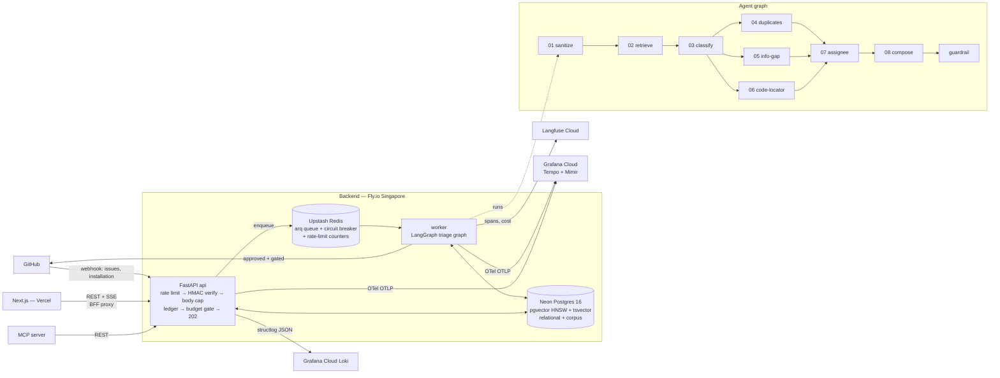

# Architecture



## Data flow for one issue

1. GitHub delivers `issues.opened` → `RequestContextMiddleware` mints `X-Request-ID` → `SecurityMiddleware` checks body size → `SlowAPIMiddleware` rate-limiter → HMAC signature verified (constant-time) → delivery written to idempotency ledger → per-installation daily budget checked (Redis INCR) → enqueued → 202 in milliseconds. Over-budget deliveries are ledgered `THROTTLED` and never enqueued; GitHub still gets 202.
2. Worker picks up the job, propagates the `request_id` through structlog context, persists the issue, creates a `triage_runs` row, executes the LangGraph graph (typed Pydantic state, bounded topology, per-node timeout, one optional strong-model escalation under the $0.02/run ceiling).
3. `retrieve` runs hybrid search twice (raw text + LLM-condensed query): pgvector cosine top-40 ∪ tsvector top-40 → RRF (k=60) → Cohere cross-encoder rerank. Per-stage scores survive to the dashboard waterfall.
4. Guardrail-approved actions land in `proposed_actions`; `decide_gate(autonomy, risk)` auto-executes what the repo's autonomy level allows (high risk: never). The rest waits in the approval inbox.
5. Every reviewer decision (dashboard or MCP) becomes a `feedback_events` row — labeled data for the eval set.
6. OTel spans + custom metrics are pushed via OTLP/HTTP to Grafana Cloud (Tempo for traces, Mimir for metrics). Structlog JSON lines flow to Loki via the Fly log shipper. Langfuse receives per-node LLM spans (model, tokens, cost, latency) via the v2 SDK post-hoc pattern.

## Processes

| Process | Role | Host |
| --- | --- | --- |
| `api` | webhooks, REST, SSE | Fly.io `sin` region (2 machines, 256 MB) |
| `worker` | arq consumer, agent graph | Fly.io `sin` region (1 machine, 256 MB) |
| `web` | dashboard (RSC + SSE relay) | Vercel (edge network) |
| `mcp` | MCP stdio/HTTP → REST | user machine / any MCP host |

## HTTP security layer

All API responses pass through a chain of middleware in this order:

```
Request
  ↓ RequestContextMiddleware — mint X-Request-ID UUID; bind to structlog context
  ↓ SecurityMiddleware       — body-size cap (413) + security headers on response
  ↓ SlowAPIMiddleware        — sliding-window rate limits (429 + Retry-After)
  ↓ CORSMiddleware           — locked to WEB_ORIGIN
  ↓ TrustedHostMiddleware    — production only: allowed_hosts=[*.fly.dev]
  ↓ Router
      ↓ require_internal     — hmac.compare_digest key check (401)
      ↓ scoped_repo_ids      — caller's visible repo IDs (IDOR guard, 404 on miss)
      ↓ handler
Response
  ↓ SecurityMiddleware       — injects HSTS, nosniff, X-Frame-Options, Referrer-Policy,
                               Permissions-Policy, strips Server header
```

## Observability layer

```
Fly.io machines (api + worker)
  │
  ├── structlog JSON → stdout → Fly log shipper → Grafana Cloud Loki
  │   Every line: request_id, level, event, latency_ms, method, path, status
  │
  ├── OpenTelemetry OTLP/HTTP → Grafana Cloud
  │   ├── Tempo — distributed traces (spans per pipeline node)
  │   └── Mimir — metrics (request rate, latency histogram, run counts, cost)
  │
  └── Langfuse SDK (post-hoc) → Langfuse Cloud
      Per triage run: trace tree with per-node model, tokens, cost, latency
```

In-app surface (no external dependency):
- `/dashboard/observability` — live p50/p95/p99, run volume, cost trend, DLQ depth, health tiles
- `/status` — public component health page (no auth)
- `GET /api/v1/observability/health` — DB + Redis + LLM liveness with actual latency
- `GET /api/v1/observability/metrics?window=24h` — real-time aggregates from Neon Postgres
- `GET /api/v1/observability/dead-letter` — failed webhook deliveries

Importable Grafana dashboard: `infra/grafana/repopilot-dashboard.json`

Full reference: [OBSERVABILITY.md](OBSERVABILITY.md)

## LLM routing

```
models.yaml
  route: classify
    provider: groq
    model: llama-3.3-70b-versatile
    fallback_provider: gemini
    fallback_model: gemini-1.5-flash
    ...

LLMRouter.complete(route, messages)
  │
  ├── check CircuitBreaker (Redis-backed, per-provider)
  │   ├── CLOSED → try primary provider
  │   │     5 consecutive failures → OPEN (60s cooldown)
  │   ├── OPEN → skip to fallback immediately
  │   └── HALF-OPEN → probe primary; if ok → CLOSED
  │
  ├── primary success → return LLMResponse(used_fallback=False)
  └── primary failure (after retries) → try fallback provider
      └── return LLMResponse(used_fallback=True, model=fallback_model)
```

Key decisions and tradeoffs: [ADRs](ADRs/). Security boundaries: [SECURITY.md](SECURITY.md). Eval gates: [EVALS.md](EVALS.md).
